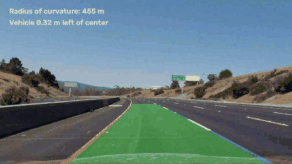
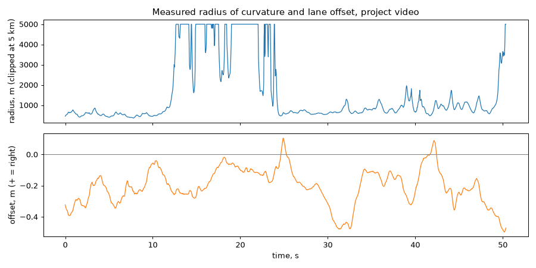
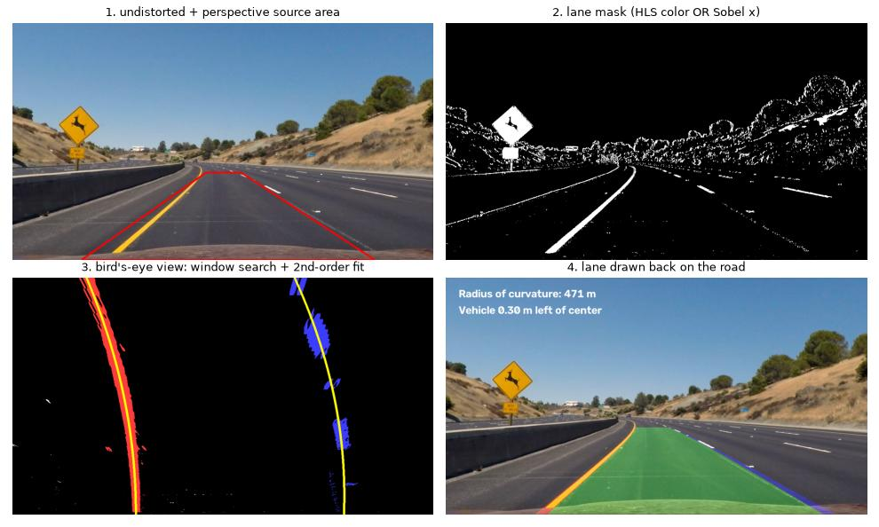
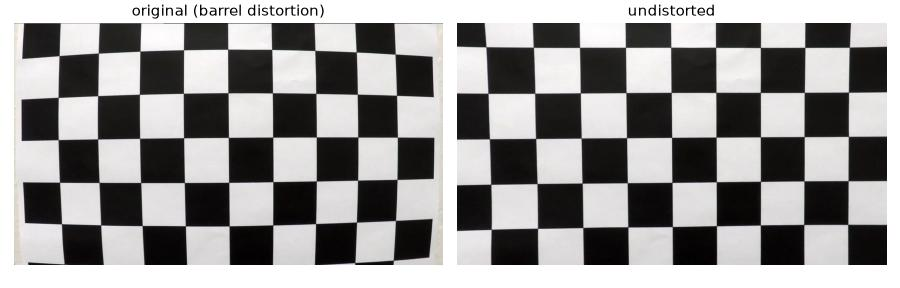

# Advanced Lane Detection: camera calibration, bird's-eye view, curved lanes

Lane detection that handles **curves** and reports **radius of curvature and vehicle offset in meters**:
camera calibration → distortion correction → color/gradient mask → perspective transform to a top view →
sliding-window search → 2nd-order polynomial fit → tracking across frames → result drawn back on the road.



## Results on the 50 s highway video (1,260 frames, 1280×720)

| Measure | Value |
|---|---|
| Camera calibration | 17 of 20 chessboard photos usable, RMS reprojection error **1.00 px** |
| Frames where the new fit failed the sanity check (previous good fit reused) | **12 of 1,260** (1%) |
| Full sliding-window searches (otherwise: search around last frame's curve) | 14 |
| Speed | **39 ms per frame** (~25 FPS) on a laptop CPU, single process |
| Radius of curvature, curved sections | median 530–920 m per 10 s segment |
| Vehicle offset from lane center | −0.50 … +0.10 m, median −0.20 m |

Checked by eye on one frame every 2 s (26 frames): the lane area stays on the lane in all of them, including
the two bridge sections with light concrete and tree shadows, which break simple color thresholds. There is
no labeled ground truth for this video, so this is a visual check, not an accuracy number.



**How exact are the meters?** The lane width (3.7 m, US highway standard) fixes the horizontal scale, which is why
the offset is reliable. The vertical scale assumes the top view covers ~30 m of road ahead; it was not measured,
so the radius is accurate in order of magnitude (hundreds of meters on curves vs. kilometers on straights), not
to the meter.

## Pipeline



| Step | File | Details |
|---|---|---|
| Camera calibration | `ald/calibration.py` | `findChessboardCorners` (9×6 inner corners) + `cornerSubPix`; `calibrateCamera` gives the intrinsic matrix K and distortion k1, k2, p1, p2, k3. This lens has strong barrel distortion (k1 = −0.25) that bends straight lane lines near the image edges |
| Lane mask | `ald/threshold.py` | HLS saturation (yellow lines, robust to shadows) OR HLS lightness (white lines) OR Sobel-x gradient on lightness (lane edges are near-vertical) |
| Bird's-eye view | `ald/perspective.py` | homography from 4 point pairs (`getPerspectiveTransform`) chosen so that lane lines on straight road become vertical at x = 320 and 960 (checked on both straight-road test images: within 13 px) |
| Lane pixels | `ald/lanefit.py` | column histogram of the lower half → two starting peaks → 9 sliding windows per line, each re-centered on the mean x of its pixels; in the next frame only pixels within 80 px of the previous curve are searched |
| Fit | `ald/lanefit.py` | x = A·y² + B·y + C per line (x as a function of y, because lines are near-vertical) |
| Sanity check | `ald/lanefit.py` | lane 3.0–4.5 m wide at the car, width varies < 0.8 m along the view (lines roughly parallel); otherwise the frame's fit is rejected |
| Smoothing | `ald/lanefit.py` | average of the last 8 accepted fits; after 5 rejected frames, restart with a full window search |
| Curvature, offset | `ald/lanefit.py` | R = (1 + x′²)^1.5 / \|x″\| after converting the fit to meters; offset = image center − lane center at the bottom row |



## Run

```bash
pip install -r requirements.txt
# the 25 MB video is not stored in this repo:
curl -L -o data/project_video.mp4 https://raw.githubusercontent.com/udacity/CarND-Advanced-Lane-Lines/master/project_video.mp4
python run.py --input data/project_video.mp4 --output output/project_video.mp4
python tools/make_figures.py
pytest -q
```

`run.py` calibrates the camera on the first run (`data/calibration.npz`), writes the annotated video and
per-frame radius/offset to `output/project_video.csv`.

## Tests

`tests/test_lanefit.py`: the fit recovers known parabolas from a synthetic top-view image (< 3 px error);
curvature of a known 800 m circle is computed exactly; straight lines give a huge radius; offset sign;
sanity check rejects a too-narrow lane and crossing lines; perspective warp ∘ unwarp returns the same point.

## Limitations

- Fixed perspective points assume a flat road and a fixed camera pitch; hills and braking change the view.
- Thresholds were tuned for daylight; the harder Udacity videos (sharp bends, strong shadows) need a more robust mask, e.g. a learned segmentation network.
- The vertical meter scale is an assumption (see above); measuring the dashed-line spacing (3 m dash + 9 m gap on US highways) in the top view would calibrate it.

## Credits

Camera calibration images, test images and video: [udacity/CarND-Advanced-Lane-Lines](https://github.com/udacity/CarND-Advanced-Lane-Lines), MIT License.
